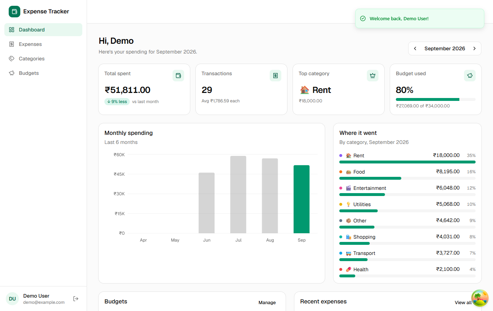
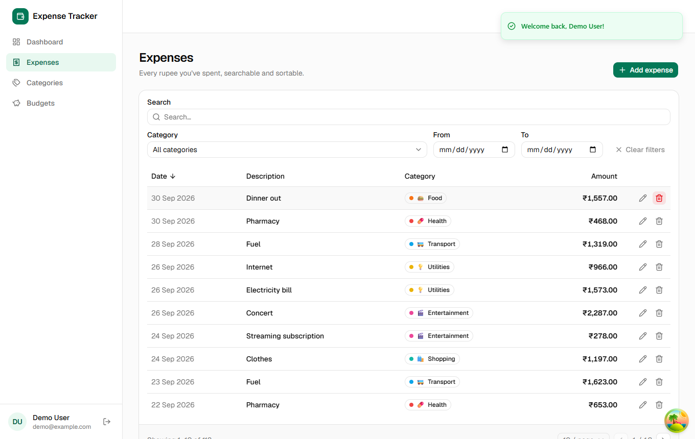
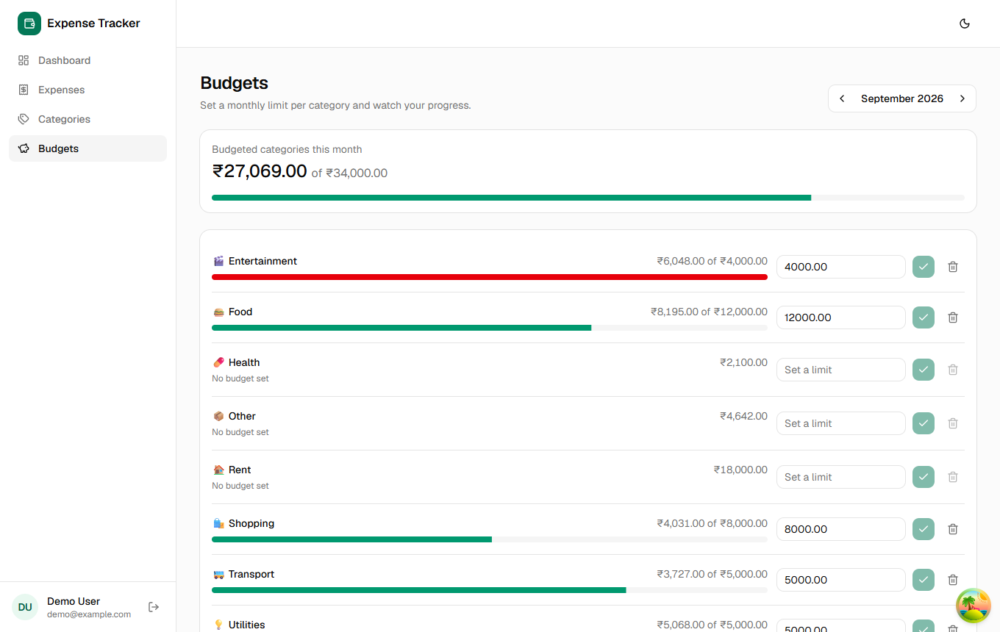
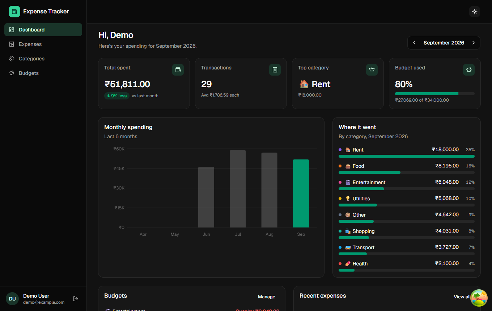
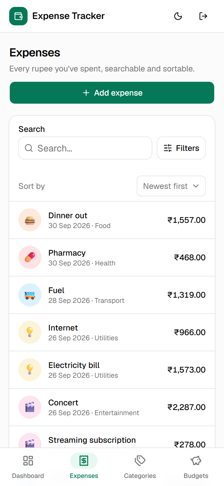
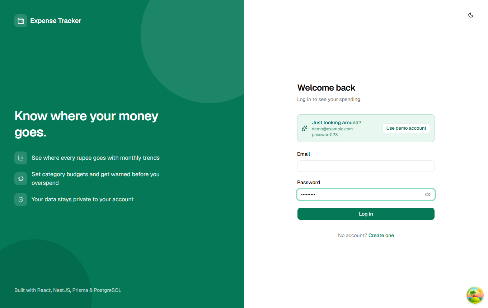
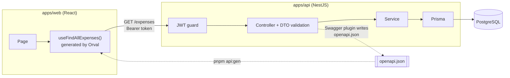

<div align="center">

# 💸 Expense Tracker

**A full-stack, type-safe expense tracker with budgets, reports, and a generated API client.**

React 19 · NestJS 12 · Prisma 7 · PostgreSQL · TanStack Query · Orval · Tailwind CSS




</div>

> **Try it locally in 2 minutes.** See [Quick start](#-quick-start), then log in with **`demo@example.com` / `password123`**. The seeded demo account has about 4 months of realistic data.

## Table of contents

- [Features](#-features)
- [Screenshots](#-screenshots)
- [Tech stack](#-tech-stack)
- [How it works](#-how-it-works)
- [Quick start](#-quick-start)
- [Scripts](#-scripts)
- [Project structure](#-project-structure)
- [API at a glance](#-api-at-a-glance)
- [Testing](#-testing)
- [Engineering highlights](#-engineering-highlights)
- [Documentation](#-documentation)
- [Roadmap](#-roadmap)

---

## ✨ Features

**Money tracking**
- Add, edit and delete expenses with amount, date, description and category.
- Search, filter by category and date range, sort by date or amount, and paginate. Filters live in the URL, so views can be bookmarked and shared.
- Custom categories with a color and an emoji. Every new account starts with eight defaults.

**Budgets & insights**
- A monthly budget per category, with live *spent / remaining* and warnings at 80% and 100%.
- A dashboard with:
  - total spent and the change against last month
  - transaction count and top category
  - overall budget usage
  - a 6-month trend chart and spending by category
  - recent expenses

**Accounts & security**
- JWT authentication with bcrypt-hashed passwords.
- Every route is protected by default. Each user sees only their own data, and another user's id returns 404.

**Experience**
- Mobile-first layout:
  - bottom tab bar on phones
  - a tap-to-edit expense list instead of the table
  - filters folded behind a button
  - larger touch targets on touchscreens
- Dark mode with no flash of the wrong theme on load.
- Loading skeletons, empty states, toasts, and a show/hide password toggle.
- Interactive API docs with Swagger UI at `/docs`.

## 📸 Screenshots

| Expenses | Budgets |
|---|---|
|  |  |

| Dark mode | Mobile |
|---|---|
|  |  |

<details>
<summary>Login</summary>



</details>

## 🧰 Tech stack

| Layer | Technology |
|---|---|
| **Frontend** | React 19, Vite 8, TypeScript, React Router (lazy routes), Tailwind CSS v4, shadcn/ui (Radix), Recharts, Zustand |
| **Data fetching** | TanStack Query v5 hooks **generated by Orval** from the OpenAPI spec, plus an axios instance |
| **Forms** | react-hook-form + zod |
| **Backend** | NestJS 12 (ESM), Passport JWT, class-validator / class-transformer, `@nestjs/swagger` |
| **Database** | PostgreSQL 16 (Docker), Prisma 7 with the `pg` driver adapter, migrations and a seed script |
| **Testing** | Vitest (unit), Supertest (e2e against a real database) |
| **Tooling** | pnpm workspaces monorepo, oxlint, Prettier |

## 🔍 How it works



The backend's DTO classes are the **single source of truth**. The same classes:
1. validate every request at runtime (`class-validator`),
2. generate the OpenAPI spec (Swagger CLI plugin),
3. and, through Orval, become the frontend's TypeScript types and React Query hooks.

Change a field on the server, run `pnpm api:gen`, and the TypeScript compiler lists every place in the UI that needs updating.

→ Full details, with diagrams of the data model and auth flow, are in [**docs/ARCHITECTURE.md**](docs/ARCHITECTURE.md).

## 🚀 Quick start

**Prerequisites:** Node.js 20.19+ / 22 / 24, pnpm 10+, and Docker Desktop (running).

```bash
# 1. Install dependencies (also generates the Prisma client)
pnpm install

# 2. Create the environment files
cp apps/api/.env.example apps/api/.env
cp apps/web/.env.example apps/web/.env

# 3. Start Postgres (Docker, host port 5434), create the tables and load demo data
pnpm db:up
pnpm db:migrate
pnpm db:seed

# 4. Run the API and web app in watch mode
pnpm dev
```

| What | URL |
|---|---|
| Web app | http://localhost:5173 |
| API | http://localhost:3000 |
| Swagger UI | http://localhost:3000/docs |

Something not working? The [troubleshooting table](docs/DEVELOPMENT.md#troubleshooting) covers Docker, ports, CORS and Prisma errors.

## 📜 Scripts

Run from the repository root:

| Command | Description |
|---|---|
| `pnpm dev` | Start the API and web app in watch mode |
| `pnpm build` | Production build of both apps |
| `pnpm db:up` / `pnpm db:down` | Start / stop the Postgres container |
| `pnpm db:migrate` | Apply migrations, or create one after editing `schema.prisma` |
| `pnpm db:seed` | Reset the demo account with fresh sample data |
| `pnpm api:gen` | Regenerate the typed React Query client from `openapi.json` |
| `pnpm test` | API unit tests |
| `pnpm --filter api test:e2e` | API end-to-end tests (needs the database) |
| `pnpm lint` | Lint both apps |

## 🗂 Project structure

```
expense-tracker/
├─ apps/
│  ├─ api/                      NestJS REST API
│  │  ├─ prisma/                schema.prisma · migrations/ · seed.ts
│  │  ├─ src/
│  │  │  ├─ auth/               register · login · me · JWT strategy · global guard · decorators
│  │  │  ├─ categories/         CRUD + ownership checks
│  │  │  ├─ expenses/           CRUD · filters · sorting · pagination
│  │  │  ├─ budgets/            monthly limits with live "spent"
│  │  │  ├─ reports/            aggregate · groupBy · raw SQL (date_trunc)
│  │  │  ├─ prisma/             PrismaService (driver adapter)
│  │  │  └─ common/             month helpers · Prisma error mapping · shared DTOs
│  │  ├─ test/                  e2e tests
│  │  └─ openapi.json           generated API contract (input for Orval)
│  └─ web/                      React SPA
│     └─ src/
│        ├─ api/                axios instance · generated/ (Orval output)
│        ├─ features/           auth · dashboard · expenses · categories · budgets
│        ├─ components/         app shell · shared UI · ui/ (shadcn)
│        ├─ lib/                money · dates · errors · query client · auth & theme stores
│        └─ routes/             router (lazy pages) · route guards
├─ docs/                        architecture · API reference · development guide · screenshots
└─ docker-compose.yml           PostgreSQL 16
```

## 🔌 API at a glance

All amounts are **integers in paise/cents** (`1250` = ₹12.50). Everything except register and login needs a `Bearer` token.

| Resource | Endpoints |
|---|---|
| **Auth** | `POST /auth/register` · `POST /auth/login` · `GET /auth/me` |
| **Categories** | `GET` · `POST /categories` · `PATCH` · `DELETE /categories/:id` |
| **Expenses** | `GET /expenses?from&to&categoryId&search&sortBy&sortOrder&page&pageSize` · `GET` · `POST` · `PATCH` · `DELETE` |
| **Budgets** | `GET /budgets?month` · `PUT /budgets` (upsert) · `DELETE /budgets/:id` |
| **Reports** | `GET /reports/summary?month` · `GET /reports/by-category?from&to` · `GET /reports/monthly?months&endMonth` |

→ Request and response examples, error formats and validation rules are in [**docs/API.md**](docs/API.md), or explore live in Swagger UI.

## 🧪 Testing

```bash
pnpm test                      # unit: ExpensesService with a mocked Prisma client
pnpm --filter api test:e2e     # e2e: the real Nest app + Postgres via Supertest
```

The e2e suite registers throwaway users and checks:
- validation errors and duplicate emails (409)
- register → login → create → search → summary
- **user isolation:** user B can't read, delete or post into user A's data
- `#rrggbb` color validation and clearing an icon with `null`
- monthly totals above the 32-bit integer limit (3,000,000,000 paise)

## 🏗 Engineering highlights

| | |
|---|---|
| 🔒 **Secure by default** | A global `JwtAuthGuard` with opt-out `@Public()`; ownership checks that return 404, not 403; bcrypt hashes never serialised; the query cache cleared on logout or 401 |
| 🧬 **End-to-end type safety** | DTO → OpenAPI → Orval → React. No hand-written API types, and contract drift is a compile error. |
| 💰 **Correct money math** | Integer paise/cents everywhere, `bigint` SQL sums, one formatting module |
| ⚡ **Performance** | Route-level code splitting (the chart library loads only with the dashboard); `keepPreviousData` paging; an `[userId, date]` index; count + page in one transaction |
| 🧠 **Thoughtful caching** | URL-prefixed query keys, so a single `invalidateSpendingData()` refreshes lists, reports and budgets together |
| 🛡 **Race-safe writes** | Prisma P2002 / P2003 / P2025 mapped to clear 409 responses instead of 500s |
| 📱 **Responsive & accessible** | Mobile-specific layouts, `pointer-coarse` touch targets, labelled icon buttons, status shown with text and icons (not color alone), charts with a validated accent color |

## 📚 Documentation

| Document | What's inside |
|---|---|
| [docs/ARCHITECTURE.md](docs/ARCHITECTURE.md) | System diagram, contract pipeline, data model (ER diagram), backend and frontend structure, auth sequence, one request followed end to end, key decisions |
| [docs/API.md](docs/API.md) | Conventions, error format, every endpoint with parameters and example JSON |
| [docs/DEVELOPMENT.md](docs/DEVELOPMENT.md) | Setup, environment variables, workflows, a recipe for adding a field end to end, testing, production build, troubleshooting |

## 🗺 Roadmap

- [ ] Recurring expenses (rent, subscriptions)
- [ ] CSV import and export
- [ ] Multi-currency support with per-user currency preference
- [ ] Refresh tokens / httpOnly cookie sessions
- [ ] Frontend component tests (Vitest + Testing Library) and Playwright e2e in CI
- [ ] GitHub Actions: lint, type-check and tests on every PR
- [ ] Docker images and a one-click deploy (API + Postgres + static web)

---

<div align="center">

Built as a hands-on learning project to practise modern full-stack TypeScript.

</div>
