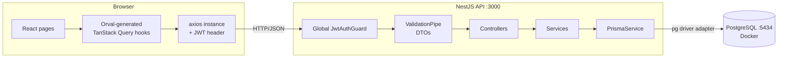
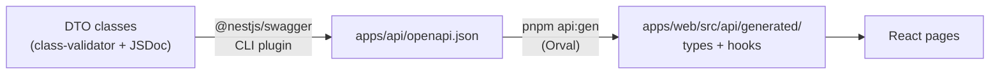
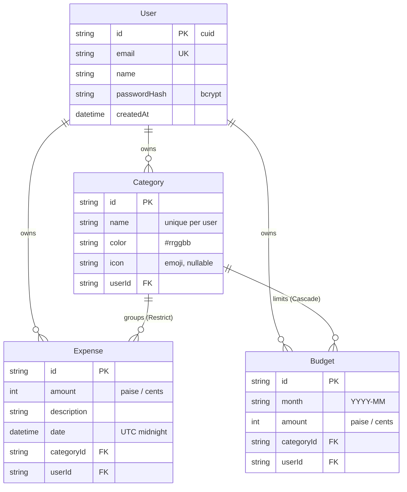
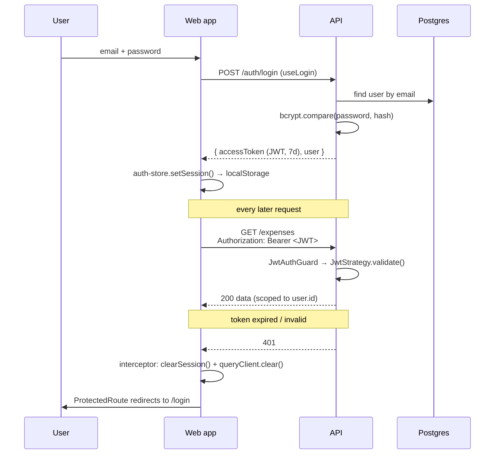

# Architecture

This document explains how the expense tracker is put together. It covers the big picture, the data model, how each app is organised, and one request followed end to end.

- [System overview](#system-overview)
- [The API contract pipeline](#the-api-contract-pipeline)
- [Data model](#data-model)
- [Backend (NestJS)](#backend-nestjs)
- [Frontend (React)](#frontend-react)
- [Authentication flow](#authentication-flow)
- [Follow a request end to end](#follow-a-request-end-to-end)
- [Key decisions](#key-decisions)

---

## System overview



| Part | Location | Role |
|---|---|---|
| Web app | `apps/web` | React single-page app served by Vite on `:5173` |
| API | `apps/api` | NestJS REST API on `:3000`, Swagger UI at `/docs` |
| Database | `docker-compose.yml` | PostgreSQL 16 in Docker, published on host port **5434** |

The two apps live in one **pnpm workspace** (`pnpm-workspace.yaml`), so a single `pnpm install` and `pnpm dev` run everything.

---

## The API contract pipeline

The frontend never hand-writes a `fetch` call or an API type. Everything comes from the backend's DTO classes:



1. **DTOs** such as [`CreateExpenseDto`](../apps/api/src/expenses/dto/create-expense.dto.ts) do two jobs. At runtime `ValidationPipe` uses their `class-validator` decorators to reject bad requests. At build time the Swagger CLI plugin (configured in [`nest-cli.json`](../apps/api/nest-cli.json)) reads the same classes, including their JSDoc comments and `@example` tags, to document the API.
2. On startup in development, [`main.ts`](../apps/api/src/main.ts) writes the spec to `apps/api/openapi.json`.
3. [`orval.config.ts`](../apps/web/orval.config.ts) turns that spec into one folder per Swagger tag (`auth/`, `expenses/`, …). For every endpoint you get:
   - a typed request function (`createExpense`)
   - a query-key helper (`getFindAllExpensesQueryKey`)
   - a React hook: `useQuery` for GET requests (`useFindAllExpenses`) and `useMutation` for everything else (`useCreateExpense`).
4. Hook names come from Swagger **operationIds**. [`swagger.ts`](../apps/api/src/swagger.ts) sets each operationId to the controller method name, which is why method names such as `findAllExpenses` and `removeCategory` are unique across the whole API.

**Why this matters:** rename a DTO field, regenerate, and `tsc` points at every frontend line that still uses the old name. The contract can't silently drift.

---

## Data model



Defined in [`prisma/schema.prisma`](../apps/api/prisma/schema.prisma). Points worth knowing:

| Rule | How it's enforced |
|---|---|
| Money is an integer in the smallest unit (₹12.50 → `1250`) | `Int` columns; the UI converts only in [`lib/money.ts`](../apps/web/src/lib/money.ts) |
| Category names are unique per user | `@@unique([userId, name])` → the API returns 409 |
| One budget per category per month | `@@unique([userId, categoryId, month])`, and `PUT /budgets` upserts on it |
| A category with expenses can't be deleted | `onDelete: Restrict` on `Expense.category`, plus a friendly 409 check in the service |
| Deleting a user removes all their data | `onDelete: Cascade` on every `userId` relation |
| Fast "my expenses in this date range" queries | `@@index([userId, date])` |

Expense dates are calendar dates stored as **UTC midnight**. The UI reads the first 10 characters (`2026-09-22`) so the user's timezone can never shift the day ([`lib/dates.ts`](../apps/web/src/lib/dates.ts)).

---

## Backend (NestJS)

```
apps/api/src/
├─ main.ts            bootstrap: configureApp(), Swagger UI, writes openapi.json
├─ app.setup.ts       global ValidationPipe + CORS (shared with e2e tests)
├─ app.module.ts      wires modules; registers JwtAuthGuard as APP_GUARD
├─ swagger.ts         DocumentBuilder + operationId = method name
├─ prisma/            PrismaService (Prisma 7 client + @prisma/adapter-pg), @Global module
├─ common/            month helpers, Prisma error helpers, shared DTOs
├─ auth/              register / login / me, JwtStrategy, @Public(), @CurrentUser()
├─ categories/        CRUD + assertOwned() used by other modules
├─ expenses/          CRUD, filters, sorting, pagination
├─ budgets/           monthly limits; "spent" via groupBy
└─ reports/           dashboard aggregates: aggregate, groupBy, raw SQL
```

Each feature folder follows the standard Nest pattern:

| File | Responsibility |
|---|---|
| `*.module.ts` | Declares the controller and providers and what the module exports |
| `*.controller.ts` | HTTP layer only: route, params, Swagger response type. No business logic. |
| `*.service.ts` | Business rules and Prisma queries. Every query is scoped by `userId`. |
| `dto/*.dto.ts` | Request shapes (validated) and response shapes (documented) |

### Cross-cutting pieces

- **Global auth.** `JwtAuthGuard` is registered as `APP_GUARD`, so *every* route needs a JWT. Routes opt out with `@Public()` ([`public.decorator.ts`](../apps/api/src/auth/decorators/public.decorator.ts)). A new endpoint is therefore protected by default.
- **Current user.** `@CurrentUser()` pulls `{ id, email }` from `request.user`, which `JwtStrategy.validate()` sets.
- **Ownership = 404.** Services look rows up with `where: { id, userId }`. Another user's id behaves exactly like a missing id (404), so the API never confirms that someone else's record exists.
- **Validation.** `whitelist` + `forbidNonWhitelisted` reject unknown fields, and `transform` + `@Type(() => Number)` turn query strings into numbers and apply DTO defaults.
- **Prisma errors → HTTP.** [`common/prisma-errors.ts`](../apps/api/src/common/prisma-errors.ts) maps Prisma error codes to HTTP responses, so races return a clear 409 instead of a 500:
  - P2002 (unique constraint) → 409, e.g. duplicate email or category name
  - P2003 (foreign key) → 409, e.g. deleting a category while an expense is being added
  - P2025 (record not found) → 409, e.g. a budget deleted mid-update

### Reports: three ways to aggregate

[`reports.service.ts`](../apps/api/src/reports/reports.service.ts) shows three levels of Prisma:

| Endpoint | Technique | Why |
|---|---|---|
| `GET /reports/summary` | `prisma.expense.aggregate` (`_sum`, `_count`) | One total for a date range |
| `GET /reports/by-category` | `prisma.expense.groupBy({ by: ['categoryId'] })` | Totals per category, sorted by `_sum` |
| `GET /reports/monthly` | `prisma.$queryRaw` with `date_trunc('month', date)` | `groupBy` can't group by a computed value. The tagged template keeps parameters bound (no SQL injection), and `SUM(...)::bigint` avoids 32-bit overflow. |

---

## Frontend (React)

```
apps/web/src/
├─ main.tsx              QueryClientProvider, RouterProvider, Toaster, theme
├─ routes/
│  ├─ router.tsx         route table; pages are lazy-loaded (code splitting)
│  └─ guards.tsx         ProtectedRoute / PublicOnlyRoute
├─ api/
│  ├─ axios-instance.ts  Orval mutator: base URL, JWT header, 401 → logout
│  └─ generated/         Orval output (never edit by hand)
├─ features/             one folder per page: auth, dashboard, expenses, categories, budgets
├─ components/           app shell and shared building blocks (ui/ = shadcn components)
└─ lib/                  money, dates, errors, query client, auth store, theme, media query
```

### Where state lives

| Kind of state | Tool | Example |
|---|---|---|
| **Server data** | TanStack Query (via Orval hooks) | expenses, budgets, reports |
| **Session** | Zustand + `persist` → localStorage | `token`, `user` ([`auth-store.ts`](../apps/web/src/lib/auth-store.ts)) |
| **Theme** | Zustand + `persist`, plus an inline script in `index.html` to avoid a flash | `light` / `dark` / `system` |
| **Filters & paging** | URL search params | `/expenses?categoryId=…&page=2` ([`use-expense-filters.ts`](../apps/web/src/features/expenses/use-expense-filters.ts)) |
| **Form input** | react-hook-form + zod | expense and category dialogs |

Rule of thumb: anything that comes from the database lives in the query cache and nowhere else. Components never copy server data into `useState`.

### Caching and invalidation

Orval query keys start with the endpoint URL, e.g. `['/expenses', { page: 2 }]`. One expense change affects the list, the dashboard, budgets ("spent") and category counts, so after any successful mutation [`invalidateSpendingData()`](../apps/web/src/lib/query-client.ts) marks every query whose key starts with `/expenses`, `/reports`, `/budgets` or `/categories` as stale. TanStack Query then refetches only the ones currently on screen.

Other query defaults:
- `staleTime` is 30 s.
- 4xx responses are never retried.
- The expense list uses `placeholderData: keepPreviousData`, so paging never flashes an empty table.

### Responsive design

- **Phones:** bottom tab bar, a tap-to-edit expense list instead of the table, filters folded behind a button.
- **Tablet/desktop (`md` and up):** sidebar, full table, inline filters.
- **Touchscreens:** buttons and inputs grow via Tailwind's `pointer-coarse:` variant, set once in `components/ui/button.tsx`, `input.tsx` and `select.tsx`.

---

## Authentication flow



- Passwords are hashed with **bcryptjs** (cost 10). Hashes never leave the service: `toUserDto()` strips them.
- Login returns the same error for "no such user" and "wrong password", so emails can't be probed.
- On logout or a 401, the query cache is cleared so the next person on the same browser never sees the previous user's data.

---

## Follow a request end to end

**"The user adds an expense."** Open these files side by side:

1. **Form:** [`expense-form-dialog.tsx`](../apps/web/src/features/expenses/expense-form-dialog.tsx). zod validates `"499.99"`, then `toCents()` turns it into `49999`. `useCreateExpense().mutate({ data })` runs.
2. **Generated client:** `api/generated/expenses/expenses.ts`. `createExpense()` builds `POST /expenses` and hands it to…
3. **Mutator:** [`axios-instance.ts`](../apps/web/src/api/axios-instance.ts), which adds `Authorization: Bearer …`.
4. **Guard:** [`jwt-auth.guard.ts`](../apps/api/src/auth/jwt-auth.guard.ts). The route isn't `@Public()`, so Passport verifies the JWT and sets `request.user`.
5. **Validation:** `ValidationPipe` checks the body against [`CreateExpenseDto`](../apps/api/src/expenses/dto/create-expense.dto.ts): `amount` must be an integer ≥ 1 and `date` an ISO date.
6. **Controller:** [`expenses.controller.ts`](../apps/api/src/expenses/expenses.controller.ts). `createExpense(@CurrentUser() user, @Body() dto)` calls the service.
7. **Service:** [`expenses.service.ts`](../apps/api/src/expenses/expenses.service.ts). `categories.assertOwned()` returns 404 if the category isn't yours, then `prisma.expense.create` runs with an explicit `select` so `userId` never leaks into the response.
8. **Back in the browser:** `onSuccess` calls `invalidateSpendingData()`, and the table, dashboard and budgets refetch. A toast confirms the save and the dialog closes.

---

## Key decisions

| Decision | Alternative considered | Why |
|---|---|---|
| Integer money in paise/cents | `Decimal` / float | No rounding errors, and Prisma `Decimal` serialises as a string in JSON |
| Generated client (Orval) | Hand-written fetch + types | Single source of truth; type errors on contract drift |
| Global guard + `@Public()` | Guard per controller | Secure by default |
| 404 for other users' rows | 403 | Doesn't reveal that the id exists |
| Filters in the URL | Component state | Refresh-safe, bookmarkable, shareable |
| Prisma 7 + `@prisma/adapter-pg` | Prisma 6 engine binary | Current Prisma architecture (no Rust query engine), ESM output |
| `bcryptjs` | `bcrypt` (native) | No native compile step on Windows/CI |
| Postgres on host port 5434 | 5432 | Avoids clashing with other local Postgres installs |
| Ranked bars for "spending by category" | Donut chart | Labelled bars are easier to compare and don't rely on user-picked colors |
